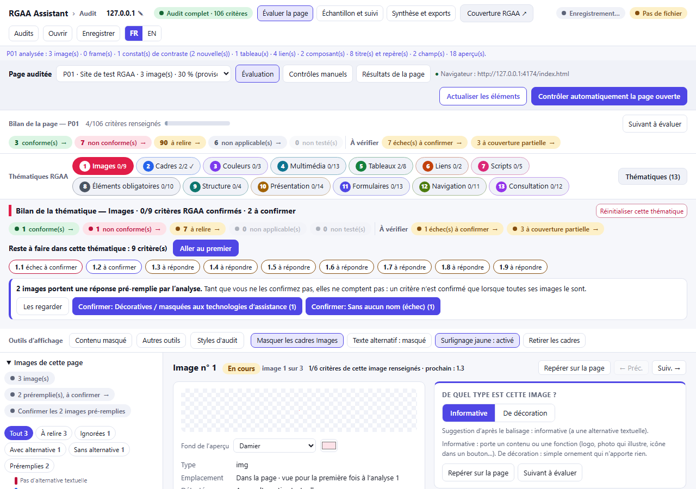
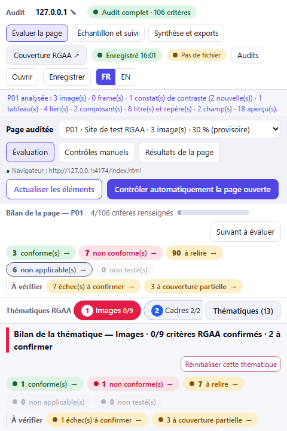

# RGAA Assistant UX UI and code review

Reviewed by Codex on 15 October 2026, against `236c837` on `master`.

## Implementation follow-up — 15 October 2026

The original observations below describe the reviewed baseline. The four P1 corrections are now implemented on
`codex/audit-integrity-fixes`; F05–F14 have now been implemented after checkpoint `pre-review-followups-2026-10-15`. See the current verification results in `WORKLOG.md`.

| Finding | Implemented correction |
| --- | --- |
| F01 | Shared audit-level eligibility suppresses compliance rates in partial dashboards, page summaries and Excel result sheets. HTML identifies the scope and exports a diagnostic without conformity wording or a statement. A full report includes a draft only when all 106 criteria are reviewed across every page, without incomplete coverage, unconfirmed answers or evidence conflicts. |
| F02 | Format v5 tracks pending answers by criterion. Choosing an image kind does not confirm its answers; clicking a verdict confirms that criterion only. Rescans/imported suggestions preserve existing human answers. Explicit bulk dialogs enumerate affected element/criterion identifiers; result calculations, review navigation and analysis packs use criterion confirmation. |
| F03 | The background queue compares a persisted storage token before writing. Stale or deleted-audit writes return a conflict; Retry offers a separate copy, reload of saved work, or staying on the local work. Tokens survive background restarts. File imports deliberately rebase on the browser revision only after replacement is chosen. |
| F04 | No detected element becomes an NA suggestion awaiting manual scope review. Known frame/shadow/truncation omissions keep per-element results incomplete. Manual criterion cards accept verdicts and notes, are included in next-review navigation and exports, preserve detected failures, and expire when the scan timestamp changes. Explicit NA answers on detected elements remain valid without a redundant decision. |

Format v5 migrates versions 2–4. Old `auto: true` answers remain pending. An old `auto: false` flag cannot reveal which
answers were implicitly confirmed by the previous defect; the migration preserves recorded decisions rather than
inventing a history. Recheck affected historical audits where that distinction matters. Unknown closed shadow roots
remain a documented limitation; this change does not add scanning inside frames or shadow roots.

### Follow-up corrections F05–F14

| Finding | Implemented correction |
| --- | --- |
| F05 | Manual questions have internal review links and an explicit criterion selector. An issue remains unresolved until its linked criterion has a confirmed NC; unrelated or automatic NC answers cannot silently resolve it. Unresolved problems keep rates provisional and appear in the summary and report, blocking a draft statement. Observations never assign verdicts. |
| F06 | HTML non-conformities include the auditor’s image note once per image/criterion, escaped with preserved line breaks, separately labelled from automatic test reasons. |
| F07 | Both URL controls validate supported addresses and duplicates. A different page starts a fresh record while retaining the original; an explicitly confirmed address correction preserves evidence with URL history shown in the sample, report and analysis pack. |
| F08 | N/J/K require Ctrl+Alt. Plain letters on unrelated controls have no effect. Image-list arrow navigation remains available; shortcuts are documented in sample settings. |
| F09 | Stable controls retain focus through rerenders, including audit-type radios, theme selection and page reordering (with an enabled fallback at the list boundary). Manual questions use fieldset/legend. |
| F10 | The top-level Current decision jump moves focus directly to the current card, including at 320px. Card continuation names its next destination; the duplicate theme-next button/count is removed. Image decisions have an accessible-name summary. Existing expanded information, counters and tools remain. |
| F11 | Element scans have an explicit busy lifecycle. Page/audit changes, batch starts and exports are blocked during collection, while sample/summary navigation stays available. Async boundaries check target identity, URL and navigation revision; interrupted scans restore their original evidence and completion never forces Evaluation. |
| F12 | Dynamic criterion guidance is translated. The translation checker now reads the instructional catalog and exits unsuccessfully for missing entries; a unit test verifies the runtime dictionary. Official grid text remains French. |
| F13 | Export-only wording replaces the promised return workflow. A local dialog previews every exact text/image file, defaults pictures off and offers HTML/text/notes/URL exclusions. It states that exclusions do not guarantee anonymity. Nothing is uploaded; saved ZIP entries match the preview. |
| F14 | Image/finding criterion helpers, review queues and Excel/analysis exports accept explicit audit scope. Library defaults are complete scope; exports no longer read the UI’s active level, and page result calculation no longer changes it. |

Format v6 adds explicit manual-problem criterion links and page URL history. Versions 2–5 migrate without inventing
links, resolutions or history. Existing v5 decisions remain intact. The checkpoint predates these additions.

### Work still to do

The remaining review follow-up is manual validation: real Firefox/DevTools, screen readers, 200%/400% zoom, forced colours,
representative large audits and novice/expert user sessions. Review density changes should be evaluated in those sessions;
they preserve the owner’s visible-information requirement. Model-answer import is still a separate planned feature.
Chromium fixture tests do not establish RGAA conformity. The historical Asqatasun 322/328 score has not been rerun;
scanner rule code and dependencies are unchanged. Evidence capture now strips the assistant’s own overlays from
finding context, matching image capture and eliminating timing-dependent overlay markup in Structure evidence.

---

RGAA Assistant has a useful technical foundation and unusually rich evidence gathering for a local browser tool. Its strongest interaction is finding an element on the inspected page, reading its evidence, and recording a criterion decision. Its largest weakness is the reliability and clarity of the transition from **what a tool detected** to **what the auditor confirmed** to **what the exported report claims**.

For an inexperienced auditor, it currently needs supervision. For an experienced auditor, it can accelerate evidence collection, but reports and confirmation state need careful review. For a developer, this is a maintainable prototype with meaningful tests, but several domain invariants are implemented inconsistently across modules. Prioritize those inconsistencies before adding more automated rules or expanding AI features.

## Scope and evidence

This is a cross-cutting product and implementation review, not a certification of the extension or a line-by-line validation of every RGAA rule. The three persona assessments are expert walkthroughs, not observations of recruited users.

I read the README, WORKLOG, previous UX plan and self-audit; inspected navigation, review, scanning, result aggregation, persistence, exports, translations, accessibility and test infrastructure; ran the existing checks; and exercised the built panel with the repository's Chromium fixture harness. Browser checks covered first use, registration, scanning, image classification, keyboard navigation, manual checks, sample settings, quick-audit summary and URL editing. Layout measurements cover 1280, 768, 480 and 320 CSS pixels. Synthetic domain probes verified exports, concurrent persistence, absent-element results and export scope.

Evidence is saved in [browser observations](review-evidence-2026-10-15/browser-results.json) and [domain observations](review-evidence-2026-10-15/domain-results.json). No product code or parity baseline was changed.

| Verification | Result |
| --- | --- |
| `npm run check` | Pass: typecheck, 221 tests in 26 files, 790 text keys / 1343 French entries / 0 missing reported, production build |
| Full `npm run test:e2e` | 36 passed, 2 failed, 2.5 minutes |
| Failed tests | Audit-pack workflow: audit overview became hidden; parity: differences in Structure checklist and audit overview sheet 2 |
| Isolated audit-pack rerun | Passed; initial failure is intermittent, not proof the workflow is sound |
| Existing panel axe test | Passed in the tested main views, light and dark, and the coverage page |
| Exploratory browser run | No captured console/page errors; concrete interaction defects below |
| Built content script | No static or dynamic module imports found |
| `21st review src/panel --json` | 45 files, 1 reported error, 91 suggestions. The missing-alt error is an `` mention in a source comment, not a rendered image. Colour suggestions include token definitions and are not 91 proven defects. |

The Playwright CLI could not be obtained because the registry was unavailable; browser exploration used the already installed Playwright library and the existing fixture harness. Local browser tests required execution outside the network-restricted sandbox. No new dependencies were installed. The UI guidance search did not return a close match for the information-density question; those recommendations rely on the observed panel and general interaction principles.

Not tested: real Firefox, a real DevTools panel, real browser-extension permissions/lifecycle, screen readers, actual 200%/400% browser zoom, text-spacing overrides, forced-colours operation, large production audits, external vulnerability auditing, or Asqatasun's downloaded fixture suite. The historical 322/328 Asqatasun result was not re-established. Narrow viewport tests are not a substitute for zoom or assistive-technology testing.

## Prioritized findings

P1 means a high-impact correctness or data-integrity issue to address before relying on the tool for deliverables. P2 means a material workflow, accessibility or communication defect. P3 means a structural risk without a reproduced failure in the ordinary UI path. These are review priorities, not RGAA verdicts for the entire application.

### F01 P1 Partial audits still generate compliance claims and statements

**Verified in the browser and export functions.** Select Audit rapide in the sample settings, then open the summary. The page warns that its figures are not an RGAA compliance rate, while the same dashboard labels them “Conformité RGAA 4” and says they should be reported in the accessibility statement. Both report buttons remain available.

With a synthetic quick audit containing just one confirmed criterion, the HTML report generated a 100% provisional rate, conformity wording and a draft statement, without identifying the 25-criterion scope. The workbook's Results sheet likewise contained “AA (Légal)”, 100% provisional, and instructions to use the figures in the statement. The Sample sheet does identify the partial scope, but does not correct these contradictory result sheets. Even in a complete audit, unfinished results can produce “totally compliant” wording before the provisional warning.

**Impact:** a beginner can export a document whose strongest claim contradicts the selected audit type; an expert must manually repair it. The project already specifies that partial audits do not support statements. Ara also documents suppression of statements for these audit types in its [release notes](https://ara.numerique.gouv.fr/notes-de-versions).

**Change:** centralize output eligibility and scope. Partial audits should export a scoped diagnostic report, without an RGAA conformity declaration. An unfinished complete audit should describe remaining assessment work rather than assert a conformity state. Use the same eligibility object in the panel, HTML and Excel.

**Acceptance:** rapid/complementary exports never produce a statement or legal-conformity claim; incomplete complete audits cannot assert total conformity; scope appears on every relevant output section.

**Source:** `src/panel/audit-overview.ts:89–105`, `src/panel/exports.ts:35–50`, `src/lib/report.ts:99–169`, `src/lib/audit-sheet.ts:284–309`, `src/lib/audit-levels.ts:20–23`.

### F02 P1 Confirming one answer confirms other answers on the element

**Verified in the browser and source.** After scanning the fixture, the first image has a pre-filled 1.1 C answer. Clicking only “Informative” removes its pre-filled status and all criterion confirmation notices. No explicit 1.1 confirmation was made. Finding cards use the same pattern: clicking one criterion clears the element-wide `auto` flag. A normal form field can have three suggested answers; confirming 11.1 can implicitly confirm 11.2 and 11.13.

**Impact:** the stored confirmation history overstates what the auditor actually decided. This is different from the explicitly labelled bulk-confirm action, which can remain available. It is also separate from the owner's decision to count decorative-image C in provisional figures; that decision need not change.

**Change:** track suggestion and confirmation per criterion, with classification confirmation separate from verdict confirmation. Bulk confirmation should identify exactly which answers it confirms. Migrate existing data conservatively.

**Acceptance:** classifying an image does not confirm its criteria; confirming 11.1 leaves 11.2 and 11.13 pending; the intended bulk action confirms its disclosed scope.

**Source:** `src/lib/types.ts:49–59`, `src/panel/images-view.ts:285–294,340–348`, `src/panel/findings-view.ts:274–289`, `src/lib/findings.ts:245–259`.

### F03 P1 Concurrent panels can silently overwrite the same audit

**Reproduced with the real persistence queue and a recording writer.** Two snapshots of the same audit are edited independently: panel A changes the auditor, panel B changes the context. Both saves return success, but the final snapshot contains only B's change. The queue protects the index when saving different audits; it does not detect stale writes to the same audit. Its revision number is acknowledged rather than compared against an authoritative stored revision.

**Impact:** someone inspecting multiple pages in separate DevTools windows can lose earlier decisions while both panels say “saved”.

**Change:** add optimistic concurrency with a stored revision and conflict response, or explicitly enforce one writer per audit. Cross-panel notification is helpful but should not replace conflict detection.

**Acceptance:** two panels editing one audit either preserve both changes or show a recoverable conflict. A stale panel cannot resurrect an audit deleted elsewhere without an explicit choice.

**Source:** `src/lib/persistence.ts:19–44`, `src/lib/audit-store.ts:222–225`, `src/panel/audit-session.ts:101–166`. Existing persistence tests cover concurrent different audits, not same-audit lost updates.

### F04 P1 Undetected elements can become fully covered NA without auditor confirmation

**Verified in domain computation and its call sites.** A scanned Forms theme with no findings produces NA with `coverage: 'full'` for 11.1, 11.2 and 11.13, with no unconfirmed flag. `computeThemes` does not receive `scanCoverage`. The same no-findings path is used even when content exists inside an unscanned frame or shadow root. The coverage card describes limitations, but those limitations do not qualify this result calculation. Per-element criteria are excluded from the normal checklist, so a missed element is also difficult to record manually.

**Impact:** absence in an incomplete scan can be presented as a completed applicability decision. An auditor's correctly recorded checklist result for such a criterion is not the ordinary override path.

**Change:** make “nothing detected” an applicability suggestion, carry known scan limitations into completion state, and provide an explicit manual finding or criterion override with rationale. Do not equate a scanner's supported subset with all relevant content.

**Acceptance:** a page whose only form is in an unscanned subtree cannot silently finish those criteria as fully covered NA; the auditor can record and resolve the manual assessment.

**Source:** `src/lib/results.ts:234–239,318`, `src/panel/model.ts:36–39`, `src/panel/checklist-view.ts:65`, `src/lib/scan-coverage.ts:36–52`.

### F05 P2 Manual problems have no direct resolution path into criterion decisions

**Verified in source and the rendered manual-check view.** “Problem found” records a manual activity and note. “Feeds RGAA” links open the external reference, not the relevant decision in this audit. These activities do not participate in criterion computation or `isProvisional`.

**Impact:** beginners can reasonably assume they have recorded the relevant non-conformity. They have actually recorded a separate activity. An unresolved manual problem can coexist with apparently finalized criterion results. This does not mean every manual activity must automatically set NC: the human must still choose the applicable criterion.

**Change:** after recording a problem, show internal links to the affected decisions, retain the observation as evidence, and expose unresolved contradictions in a final-review checklist. Label activities clearly as supporting work.

**Acceptance:** a keyboard problem has a visible path to its criterion(s), and an unresolved contradiction is identified before final reporting.

**Source:** `src/panel/checks-view.ts:70–88`, `src/lib/audit-sheet.ts:66`, `src/panel/model.ts:36–39`.

### F06 P2 HTML reports omit the auditor's image-specific explanation

**Reproduced with a synthetic NC image and a unique human note.** The HTML report included the failing test and generic reason but omitted the image review note. Image failures read test reasons and checklist notes; finding failures do include finding notes. Excel handles image notes elsewhere, so exported evidence differs by format.

**Impact:** the remediation team can receive the criterion number without the auditor's explanation or proposed alternative text.

**Change:** include the relevant image notes once per referenced image, with its stable identity and criterion context. Keep automatic evidence and human explanation distinguishable.

**Acceptance:** a note written for an NC image survives JSON, Excel and HTML export, including escaping and multiline formatting.

**Source:** `src/lib/report.ts:52–62`; contrast with `src/lib/audit-sheet.ts:396`.

### F07 P2 URL editing accepts invalid addresses and retains old evidence

**Verified in the browser.** Replacing the sample URL with `not-a-url` and tabbing out retained the value and displayed “Enregistré”. `type="url"` does not enforce validity for these custom change handlers. Changing a valid URL also keeps the previous findings and answers attached to the renamed page. “Use current URL” bypasses the duplicate check applied by the editable URL field.

**Impact:** a typo damages navigation; reassignment can label historical evidence with a different page address. Legitimate URL corrections should remain possible.

**Change:** validate supported navigable URLs before mutation, apply duplicate checks consistently, and distinguish correcting an address from replacing the page. On replacement, require an explicit treatment of existing evidence and show that a fresh assessment is needed.

**Acceptance:** invalid values produce a local error without saving; replacement cannot silently relabel old evidence; duplicate protection is the same for both controls.

**Source:** `src/panel/sample-view.ts:88–104,120`, `src/lib/audit-store.ts:35–43`.

### F08 P2 Global character shortcuts are not user-controllable

**Verified in the browser.** With keyboard focus on the audit-name button, pressing `j` selected another image. The document-level handler enables `j`, `k` and `n` outside text inputs, without an off switch or remapping setting and without restricting them to the relevant component.

This is a concrete mismatch with [RGAA 12.10.1](https://accessibilite.numerique.gouv.fr/methode/criteres-et-tests/#12.10), which provides disabling, remapping with modifiers, or component-focus restriction as alternatives. Passing axe does not test this behaviour.

**Change:** preserve useful shortcuts through a discoverable disable/remap control or focus-scoped handling. Do not remove the working arrow-key list navigation.

**Acceptance:** single-letter input on unrelated controls cannot move the review unexpectedly; settings are keyboard accessible and remembered.

**Source:** `src/panel/events.ts:96–105`.

### F09 P2 Rerenders lose focus and manual radio groups lack question context

**Verified in the browser.** Choosing the quick-audit radio rebuilt the sample view and left `document.activeElement` as BODY. Manual-check answers have repeated labels such as “Checked, OK”, but each question and its three radios are wrapped in a plain div rather than a labelled group. Each radio has a label; the missing association is the shared question. Screen-reader impact still needs an actual screen-reader test.

**Change:** restore focus to the equivalent control after a rerender; use fieldset/legend or an equivalently named radio group for each manual question. Audit theme menus and reorder controls for the same rerender pattern.

**Acceptance:** arrow-key interaction with audit type continues through the group; assistive technology identifies the question when entering a manual answer group.

**Source:** `src/panel/sample-view.ts:62–68`, `src/panel/checks-view.ts:78–88`.

### F10 P2 Repeated summaries displace the decision workspace

**Measured after scan completion.** In the fixture, after confirming the first image's classification, the image detail started at approximately y=1,151 at 768 px, y=1,475 at 480 px, and y=2,053 at 320 px. The 480 px page was about 7,279 px tall. There was no document-level horizontal overflow at these widths. At 1280×900, the audit controls, page controls, two summaries, remaining-work chips, confirmation block and display tools consume most of the initial viewport.

The interface has consistent cards, readable status text and useful colour coding. The problem is competing emphasis: many pills, outlined buttons, primary buttons and repeated next actions all demand attention before the decision itself. Small 12–13 px metadata adds to the density; this is a readability concern, not a claim that every small label fails RGAA.

**Change:** keep the owner's visible-information and visible-tools decisions. Reduce repetition, align related controls, make one next target explicit, and offer a direct “Current decision” jump. Keep the evidence required for the current decision close to it: on narrow screens, the full preview/evidence currently follows the entire stack of criterion cards. A compact preview/name summary next to the current question would help image-relevance decisions.

**Acceptance:** the current decision is reachable directly in a narrow panel; next controls disclose their destination; summaries retain clear audit/page/theme scope without repeating the same work queue in several equally prominent forms.

**Source:** `src/panel/panel.html:11–136`, `src/panel/theme-todo.ts`, `src/panel/panel.css:709–740`, `src/panel/images-view.ts:184–224`.

### F11 P2 An element scan can take the user back to Evaluation after navigation

**Observed intermittently in the full browser suite; supported by the implementation.** The audit-pack test reached the summary action but the overview was hidden when checked. It passed alone. The shared scan helper stops waiting as soon as the “Scanning” status changes, although preview capture can still be running. At completion, `scan()` unconditionally selects the review view. Unlike the full automatic runner, the standalone scan does not establish its own busy state at entry.

**Impact:** navigation during preview capture can be overridden. The test helper also permits tests to assert an intermediate state. The exact trace of every intermittent failure was not reconstructed; the scan-completion navigation path is a concrete explanation requiring a deterministic regression scenario.

**Change:** give every scan an explicit lifecycle, bind asynchronous work to the intended audit/page, and either prevent conflicting navigation with visible feedback or preserve the user's subsequent navigation. Make tests wait on completion rather than a transient status string.

**Acceptance:** navigate to the sample or summary during deliberately delayed preview capture; completion cannot silently switch the view back or attach results to another page.

**Source:** `src/panel/scan-flow.ts:19–25,81–92`, `src/panel/events.ts:44`, `e2e/harness.ts:140–145`, `e2e/audit-pack.spec.ts:11–20`.

### F12 P2 French guidance remains partly English despite the translation check

**Verified in the rendered Images checklist.** The 1.4 and 1.5 guidance includes English sentences beginning “Needs a human…”. `c.note` is rendered directly. The translation checker scans literal `t(...)` calls and therefore does not catch this omission.

**Change:** route dynamic guidance through the translation mechanism and validate the dynamic source catalog. Preserve intentionally French official-grid content.

**Acceptance:** French screenshots contain translated instructional notes; removing a dynamic catalog translation makes a relevant check fail.

**Source:** `src/panel/checklist-view.ts:101`, `src/lib/themes.ts`, `scripts/check-i18n.mjs:12–23`.

### F13 P2 LLM export overpromises the return workflow and understates text sensitivity

**Verified in source and a synthetic cleaning probe.** The success message asks users to bring the answers file back, but the import/application workflow is not built. The export dialog offers a picture choice and aggregate counts, not a preview of the text being exported. `cleanHtml` removes scripts/styles/large inline data, but retains text and values such as a hidden input's literal value. Omitting pictures therefore does not make the pack anonymous.

**Impact:** a beginner expects a working round trip, and may overestimate what “without pictures” excludes. The app does not upload the pack; this finding concerns informed manual sharing, not an observed network disclosure.

**Change:** label the current feature as export-only; warn about HTML, nearby text, URLs and notes as well as pictures; provide a local payload preview and explicit exclusions/redaction controls before broader use on sensitive pages. Avoid claiming that automated redaction can guarantee anonymity.

**Acceptance:** the UI does not promise an unavailable import; a user can inspect text-bearing payload fields before saving a shareable pack.

**Source:** `src/panel/exports.ts:54–69`, `src/lib/audit-pack.ts:31–38,90–118`, `docs/PLAN-llm-roundtrip.md`.

### F14 P3 Pure export behaviour depends on mutable UI-level scope

**Reproduced at the library boundary.** For the same complete-audit object containing a form field, `buildPack` omitted question 11.13 when the module's active level was rapide, and included it when the active level was complet. It reads `criteriaFor` / `findingCriteriaOf`, which use global scope, before applying the audit argument's own scope. Current panel rendering normally sets that global correctly; no ordinary export UI failure from this cause was reproduced.

**Change:** make criterion selection explicitly accept audit level; export and result functions should depend only on their inputs. Avoid changing one module's global state merely to calculate another page's results.

**Acceptance:** identical audit inputs produce identical question sets regardless of which audit or view was rendered previously.

**Source:** `src/lib/audit-levels.ts:35–38`, `src/lib/audit-pack.ts:84,107`, `src/lib/findings.ts:169`, `src/panel/model.ts:36`.

## Developer assessment

The TypeScript/Vite stack is appropriate. A framework rewrite is not justified by the findings. The thin bootstrap, explicit action registry, separation of injected content code from panel code, schema validation, migrations, queued persistence and local exports are assets. Tests cover real user workflows and persistence failure paths, not only rendering snapshots. The recent contrast, landmark and focus-style work is useful and passed the existing axe scenarios.

The main architectural improvement is to centralize **decision state, scope, coverage and report eligibility**. Currently images, findings and checklists have different confirmation models, while the panel, workbook and report interpret those models separately. A shared domain result should distinguish suggested verdict, confirmed verdict, coverage limitation, unresolved evidence and applicable audit scope. It should not derive human confirmation from an element-wide boolean or from the absence of scanner findings.

Rendering also has hidden effects: it sets global scope and some render functions initialize answer records. Separate data transitions from rendering incrementally. Preserve explicit actions and the content-script isolation invariant. Consolidate CSS layers: earlier layout/overflow rules are superseded by later blocks, making changes harder to reason about. Existing tokens should remain the basis for colours; the static review's token warnings are not a reason to replace them.

Performance needs measurement on representative large audits. Whole-view rebuilds, repeated flattened result computation, full-audit cloning/validation during saves and synchronous ZIP construction are plausible scaling costs, but this review did not benchmark them. Measure time to first decision, scan completion, typing responsiveness and export memory before selecting optimizations. Add meaningful tests for same-audit concurrency, scope-sensitive exports, individual confirmations, missing scan coverage and asynchronous navigation.

The current release gate is not clean: the complete browser suite failed even though core checks passed. Do not update parity hashes to conceal it. The Structure parity difference is already documented as flaky; the second difference must be inspected rather than assumed harmless. WORKLOG's top summary still describes an older branch and counts than the recent handoffs. Align it so the next developer sees the actual baseline.

## Inexperienced auditor assessment

The starting action “Add the current URL as P01” is understandable. Element numbering, locating controls, image previews, plain-language image questions and manual “How to check” instructions are good teaching aids. Saving in the browser with a visible status and keeping a separate backup indicator also helps.

The harder question is what an action means. “Repérer”, automatic checks, suggested answers, pre-filled answers, “à relire”, “à confirmer”, partial coverage and manual activities refer to different states that look similar. The novice must also move between element-level, criterion-level, theme-level, page-level and audit-level reasoning. A coloured C or a 100% number is more persuasive than a qualification elsewhere on the screen.

Use a persistent short path: **prepare the sample → collect evidence → review suggestions → perform manual checks → resolve remaining decisions → review the output**. This should be guidance, not a mandatory rigid wizard. Explain NA as a human applicability decision, distinguish “not tested” from “no element detected”, and show worked examples beside difficult questions. Keep official tests available, but do not force a novice to leave the tool merely to understand the next action.

Sample preparation needs more support than a URL list: page purpose, representative templates, essential processes, dynamic states and test environment. These are recommendations, not claims that every audit must use one fixed page count. The official [evaluation method](https://accessibilite.numerique.gouv.fr/obligations/evaluation-conformite/) bases an audit on a representative sample and makes whole-sample conformity depend on all relevant pages.

For beginner validation, ask participants to register a small sample, distinguish scan completion from audit completion, explain why an empty-alt image is not automatically proven decorative, record a keyboard problem, and produce a correctly scoped diagnostic export. Observe wrong decisions and recovery, not only speed. Success should include their ability to explain what remains untested without prompting.

## Experienced auditor assessment

The strongest features are local evidence retention, locating elements, code/context views, manual visual aids, criterion links, multiple automatic engines with visible disagreements, and exports. APG structural checks and keyboard prompts provide a useful starting point, provided a passing structural check remains evidence rather than proof of component accessibility.

Professional work needs stronger provenance: per-criterion confirmation, a stable distinction between current and historical evidence, manual additions for missed elements, and a record of relevant page states and test environments. The current page identity removes URL fragments. This intentionally groups popins and tabs, but also merges distinct hash-routed screens. That is a product limitation to handle with explicit state records, not a reason to indiscriminately stop normalizing fragments.

Keeping disappeared elements is valuable when a dialog closes. It also means rescans are cumulative evidence rather than a clean retest of the current page. Offer explicit “historical state”, “removed after correction” and “retest required” handling rather than silently deleting prior findings. A final report should let the auditor explain which state each finding belongs to.

For larger audits, consider reusable observations for shared components, cross-page criterion review, a searchable criterion/element index, per-test rationale and retest comparison. Reuse must remain explicit: the same component can behave differently in another context. Export completeness and traceability should come before adding more presentation charts.

For expert validation, use a real multi-page site with a modal, a validation error state, a repeated header, an embedded frame and a component in a shadow root. Check whether the auditor can record missed findings, retain state-specific evidence, revisit a correction, reconcile contradictory tools and hand a developer a report containing every necessary explanation.

## UI direction and delivery sequence

Keep the established information-visible default and visible display tools. Improve hierarchy by removing duplication and making context explicit. Use one primary continuation pattern with a concrete target, such as “Next: image 3 · criterion 1.3”. Keep reset actions available but visually quieter than the current decision. Use colour primarily to communicate status; theme colour should be a secondary orientation cue. Retain text labels so status never depends only on colour.

The wide and narrow captures show why structural changes matter more than cosmetic polish:

| Order | Work package | Exit condition |
| --- | --- | --- |
| 1 | Result integrity: F01, F02, F04, F06 | A confirmation means exactly what the auditor selected; scoped exports preserve evidence and never overclaim |
| 2 | Data safety and asynchronous work: F03, F07, F11 | Concurrent saves and scans cannot silently discard or misattribute work |
| 3 | Accessible decision flow: F05, F08, F09, F10, F12 | Keyboard focus is stable; manual findings reach decisions; narrow panels prioritize current work |
| 4 | Export and architecture cleanup: F13, F14 | Shareable payload is inspectable, workflow promises are accurate, exports are independent of UI globals |
| 5 | Real-auditor validation and extension QA | Novice and expert tasks succeed in real Firefox/DevTools; accessibility checks extend beyond axe |

For each implemented package, run the existing required checks and add targeted regressions for the corrected behaviour. Review parity changes only for intentional interface changes. Data-model changes require migration tests. Preserve the existing decorative-image counting decision while making its provisional/confirmed meaning consistent everywhere.

The next useful milestone is a trustworthy end-to-end audit: the auditor understands the next decision, knows what is still untested, cannot silently lose work, and can export a document that faithfully represents their decisions.
